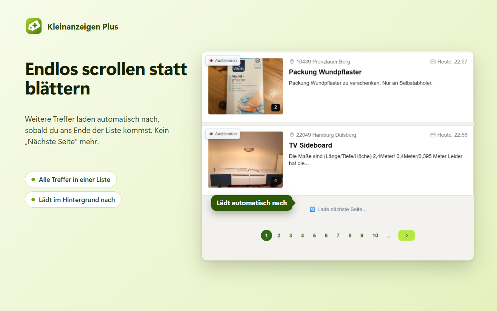
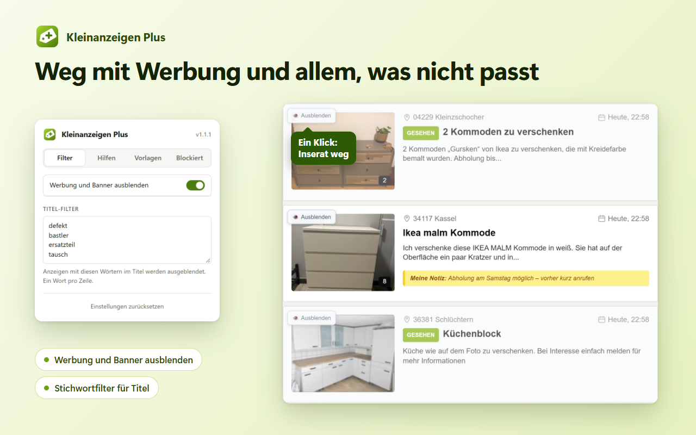
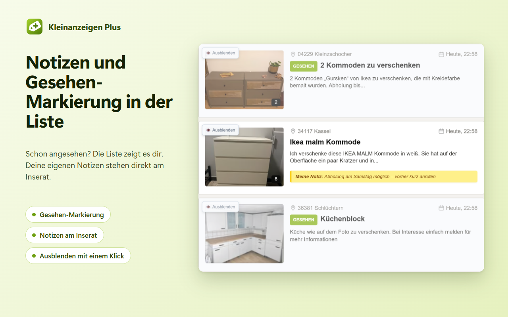
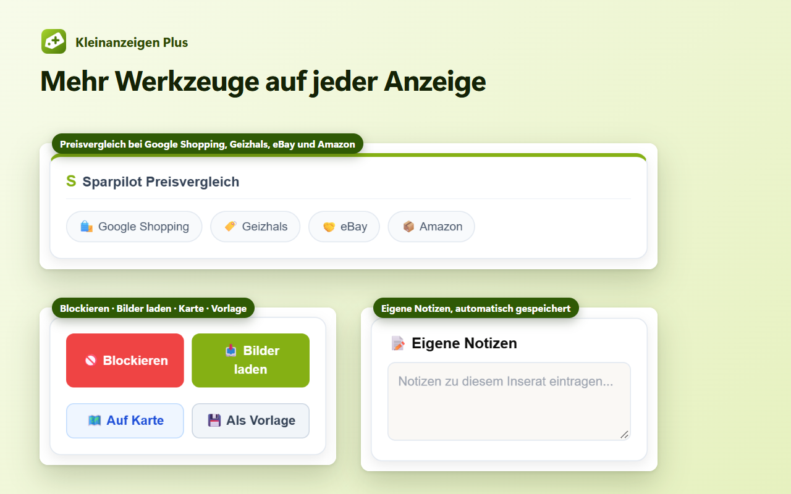
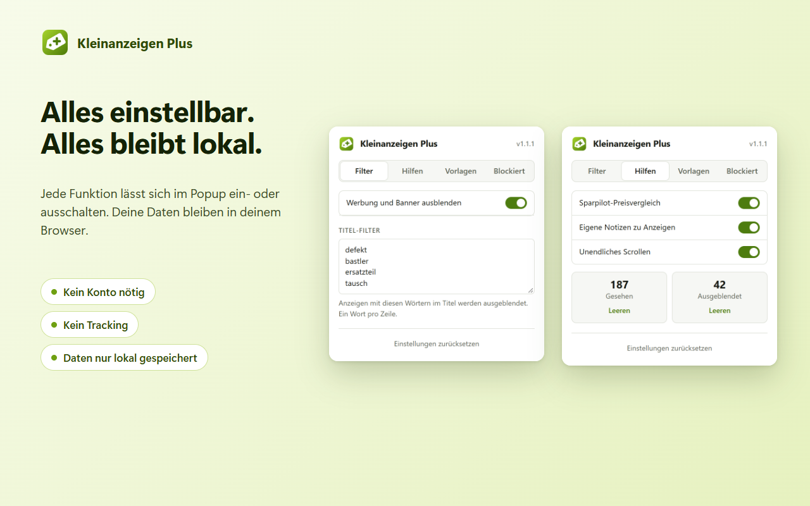

<h1 align="center">Kleinanzeigen Plus</h1>

<b>A browser extension that makes kleinanzeigen.de cleaner and faster: endless scrolling, filters, notes and more. Everything runs locally: no account, no tracking.</b>

  
  
  
  

> **Note:** Kleinanzeigen Plus is made for the German classifieds site [kleinanzeigen.de](https://www.kleinanzeigen.de) (formerly eBay Kleinanzeigen), so the extension's interface is in German. It is an independent project and is not affiliated with Kleinanzeigen or eBay.

## Features

- **Endless scrolling**: the next result pages load automatically when you reach the end of the list. Can be switched off in the popup.
- **Hide ads**: banners and ad slots in the result list and on the page are hidden; the layout stays unchanged. The cookie dialog is not touched.
- **Hide single listings**: a "Ausblenden" button on every photo hides a listing for good. The list of hidden listings can be cleared in the popup.
- **Keyword filter for titles**: listings whose title contains words such as "defekt" or "Bastler" are hidden automatically. You edit the word list in the popup.
- **"Gesehen" marker**: listings you already opened are marked in the list (up to 500 are remembered).
- **Notes**: write your own note on any listing page; it also shows in the result list under the listing.
- **Price comparison**: search the item on Google Shopping, Geizhals, eBay and Amazon with one click.
- **Download images**: save all photos of a listing into its own folder (`Kleinanzeigen_<listing ID>`) in your Downloads folder.
- **Block sellers**: block a seller on the listing page; their listings are hidden afterwards. Manage the list in the popup.
- **Map and templates**: open a listing's location in Google Maps, and save a listing as a template for new ads.
- **Reply snippets and CSV export**: insert standard questions into the message field with one click; export the shown search results as CSV (ID, title, link).

| | |
|---|---|
|  |  |
|  |  |

## Install

- **Chrome, Brave and other Chromium browsers:** [Chrome Web Store](https://chromewebstore.google.com/detail/mnfgejplbhbkedcolciflhihgokpjnnd)
- **Microsoft Edge:** [Edge Add-ons](https://microsoftedge.microsoft.com/addons/detail/kleinanzeigen-plus/ncgkiamlocngkencbhjpjjppbjofffih)
- **From source:** see [Development](#development).

## Getting started

1. Install the extension, open [kleinanzeigen.de](https://www.kleinanzeigen.de) and search for something. The features are active right away.
2. Click the extension icon to switch single features on or off, edit the keyword list or manage blocked sellers. The popup follows your system's light or dark theme.

## Permissions and privacy

All data (settings, notes, blocked sellers, hidden listings, templates) stays in your browser. The extension sends nothing to a server of the developer; to load further result pages it only requests kleinanzeigen.de itself. Price comparison and the map open the respective site in a new tab when you click. Read the [privacy policy](PRIVACY.md).

| Permission | Why it is needed |
|---|---|
| Access to `www.kleinanzeigen.de` only | the extension works only on that site |
| `storage` | save your settings, notes and lists locally |
| `downloads` | save a listing's images when you click "Bilder laden" |

## Support

- Questions, bugs or ideas: [open an issue](https://github.com/exUs541/Kleinanzeigen/issues).
- More about Kleinanzeigen Plus and the other extensions: [exus541.github.io/portfolio](https://exus541.github.io/portfolio/index.html), with a [feedback form](https://exus541.github.io/portfolio/feedback.html).

## Development

The extension runs straight from this folder, there is no build step.

1. Clone the repository.
2. Open `chrome://extensions` (or `edge://extensions`) and switch on **Developer mode**.
3. Choose **Load unpacked** and select the repository folder.

| Path | Purpose |
|---|---|
| `manifest.json` | extension manifest (Manifest V3) |
| `background.js` | service worker (image downloads) |
| `content.js`, `content.css` | everything on kleinanzeigen.de pages |
| `popup.html`, `popup.js`, `popup.css` | settings popup |
| `icons/` | extension icons |
| `tests/` | `node tests/test_js.js` runs `content.js` against a mocked browser |
| `store-assets/` | store texts, screenshots and logo, see its [README](store-assets/README.md) |
| `.github/` | release pipeline, see [RELEASING.md](.github/RELEASING.md) |

Kleinanzeigen is a trademark of Kleinanzeigen GmbH, eBay is a trademark of eBay Inc. Both names are used only to describe compatibility.
